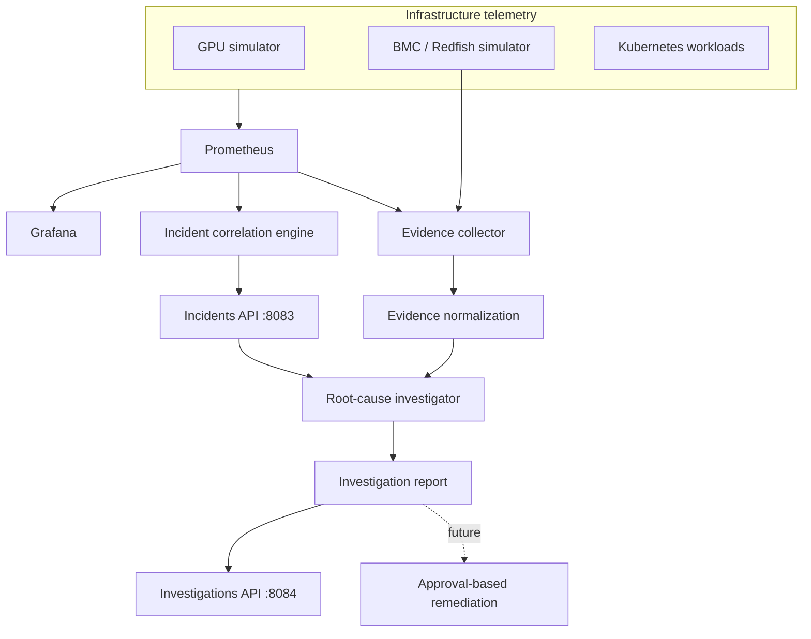
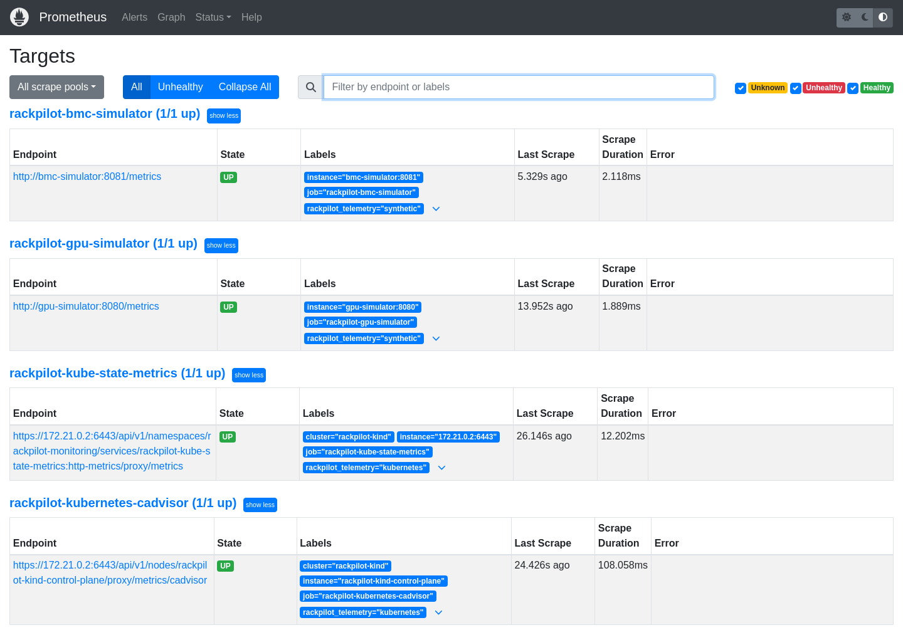
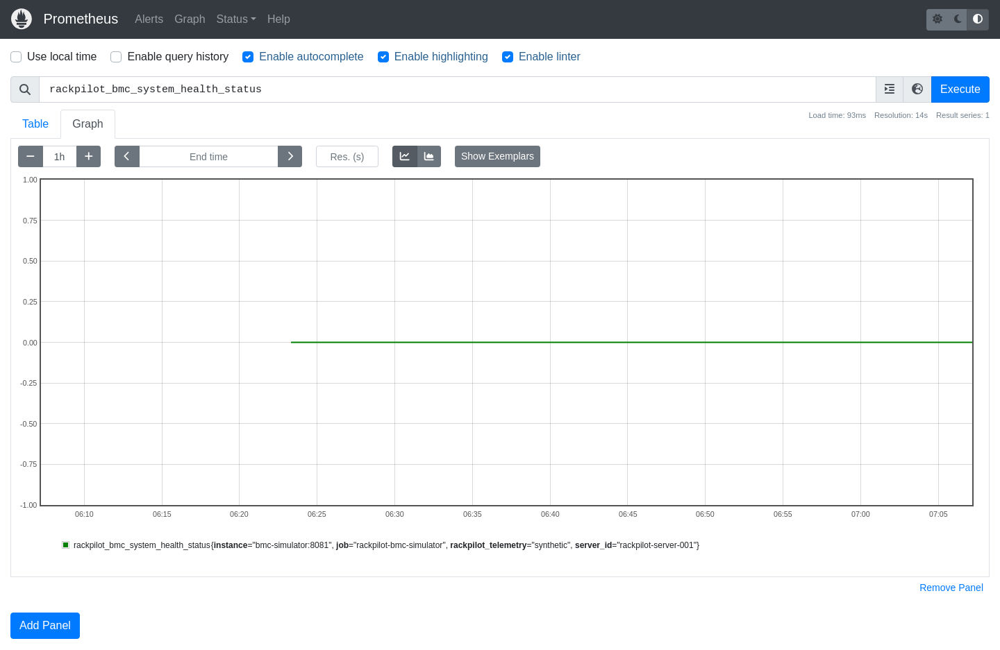
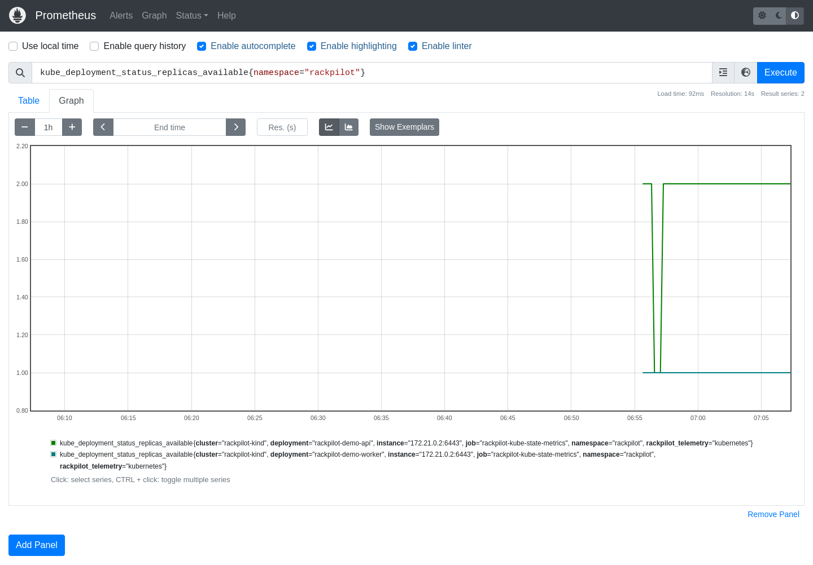
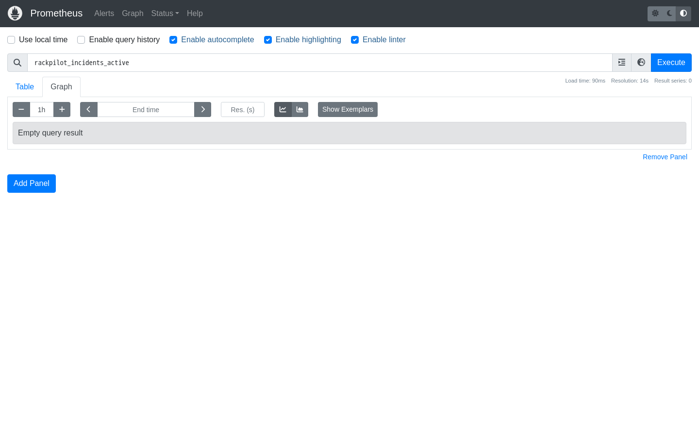

# RackPilot AI

**AI infrastructure monitoring, incident correlation, and evidence-backed root-cause investigation** — built as an open-source lab that unifies GPU, server hardware (BMC/Redfish), Kubernetes, and Prometheus signals.

> Default GPU/BMC telemetry and most Redfish responses are **synthetic**. They demonstrate patterns for learning and portfolio use, not live production hardware.

## The problem

Modern AI infrastructure spans many layers: **GPU compute**, **server hardware**, **BMC/Redfish**, **cooling and power**, **Kubernetes workloads**, and **Prometheus observability**.

When something breaks, engineers jump between dashboards, hardware interfaces, and logs. Monitoring can show **abnormal metrics**, but it rarely:

- Explains **relationships** between related failures  
- Surfaces **likely root causes** with **evidence**  
- Produces a structured **investigation narrative** engineers can act on  

RackPilot AI experiments with closing that gap using deterministic correlation first, then read-only evidence collection and investigation.

## What RackPilot solves

RackPilot brings together:

| Signal domain | Role in RackPilot |
|---------------|-------------------|
| GPU telemetry | Utilization, temperature, memory pressure |
| BMC / Redfish | Fans, PSU, thermals, event logs |
| Kubernetes (kind lab) | Pod restarts, deployment availability |
| Prometheus | Single query language across domains |
| Incident engine | Correlates multi-signal incidents |
| Investigator | Collects evidence and produces root-cause **reports** |
| Remediation (future) | Approval-gated actions — **not implemented** |

**Why combine signals?** A fan failure can precede GPU throttling; a PSU fault can correlate with workload unavailability. Independent silos hide these links; RackPilot normalizes observations and correlates them before investigation.

## How it works



| Stage | Status |
|-------|--------|
| Telemetry + Prometheus + Grafana | **Implemented** |
| Incident correlation (Milestone 5) | **Implemented** |
| Evidence collection + deterministic investigation (Milestone 6) | **Implemented** |
| Optional LLM enrichment | **Implemented** (off by default) |
| Approval-based remediation | **Planned** |

Deep dives: [incident correlation](docs/incident-correlation.md) · [investigation](docs/investigation.md)

## Real-world use cases (lab scenarios)

| Scenario | What RackPilot detects | What investigation should establish |
|----------|------------------------|-------------------------------------|
| **GPU overheating** | GPU temp/util thresholds in Prometheus | Temp trend, utilization context; whether BMC thermals correlate |
| **BMC fan failure** | `hardware_cooling` incident (fan health critical) | Fan health/speed evidence IDs, missing thermal history, hardware checks |
| **PSU failure** | `power_supply` incident | PSU + system health series, event log snippets, redundancy checks |
| **K8s workload instability** | `kubernetes_workload` incident | Restart counters, desired vs available replicas |
| **Memory pressure** | `memory_pressure` incident | BMC memory errors + container memory working set |
| **Multiple related signals** | Correlation rule merges contributors | Timeline ordering; hypotheses with supporting evidence IDs |

Trigger examples:

```bash
# Fan failure → cooling incident
curl -X POST http://127.0.0.1:8082/api/v1/scenarios/fan-failure \
  -H 'Content-Type: application/json' -d '{"component_id":"fan-0"}'

# GPU overheating
curl -X POST http://127.0.0.1:8080/api/v1/scenarios/overheating \
  -H 'Content-Type: application/json' -d '{"gpu_ids":["gpu-0"]}'
```

## Current implementation (milestones)

| Milestone | Capability |
|-----------|------------|
| M1 | Go GPU telemetry simulator |
| M2 | Docker Compose observability stack |
| M3 | BMC/Redfish simulator + metrics |
| M4 | DMTF Redfish fixture mode + kind Kubernetes monitoring |
| M5 | Deterministic incident correlation engine |
| M6 | Evidence-backed root-cause investigator (read-only) |
| M7 | Kubernetes deployment of GPU, BMC, incident engine, investigator |

## Technology stack

- **Go 1.23** — simulators, incident engine, investigator  
- **Docker Compose** — isolated `rackpilot` project  
- **Prometheus / Grafana** — metrics and dashboards  
- **kind** — optional Kubernetes lab  
- **PromQL** — unified metric access for correlation and evidence  

## Repository layout

```
cmd/                     # gpu-simulator, bmc-simulator, incident-engine, investigator
simulator/gpu/           # GPU domain, metrics, HTTP API
simulator/bmc/           # BMC/Redfish, fixtures, metrics
incident/                # correlation engine (M5)
investigation/           # evidence + investigation (M6)
deployments/docker/      # Compose stack
deployments/kubernetes/  # kind config, workloads, scrape RBAC
monitoring/              # Prometheus + Grafana provisioning
testdata/redfish/dmtf/   # DMTF fixture subset (BSD 3-Clause)
docs/                    # guides and screenshots
```

## Prerequisites

- Linux or macOS with **Docker**  
- **Go 1.23+** for local builds  
- ~4 GiB RAM for Compose + optional kind  
- Optional: **kind**, **kubectl** for Kubernetes milestone  

## Quick start (Docker Compose)

```bash
git clone https://github.com/anil-debug/rackpilot-ai.git
cd rackpilot-ai
cp deployments/docker/.env.example deployments/docker/.env

docker compose -p rackpilot -f deployments/docker/docker-compose.yml up -d --build
```

Health checks:

```bash
curl -s http://127.0.0.1:8080/health | jq .
curl -s http://127.0.0.1:8082/health | jq .
curl -s http://127.0.0.1:9090/-/healthy
curl -s http://127.0.0.1:3000/api/health | jq .
curl -s http://127.0.0.1:8083/api/v1/health | jq .
curl -s http://127.0.0.1:8084/api/v1/health | jq .
```

| Service | URL |
|---------|-----|
| Grafana | http://127.0.0.1:3000 |
| Prometheus | http://127.0.0.1:9090 |
| GPU API | http://127.0.0.1:8080 |
| BMC / Redfish | http://127.0.0.1:8082 |
| Incidents API | http://127.0.0.1:8083 |
| Investigations API | http://127.0.0.1:8084 |

Stop RackPilot only (preserves SSD bind mounts):

```bash
docker compose -p rackpilot -f deployments/docker/docker-compose.yml stop
```

Avoid `docker compose down -v` if you rely on `/mnt/ssd/rackpilot-data` persistence — see [docs/observability-docker.md](docs/observability-docker.md).

## Deployment options

| | Docker Compose | Kubernetes (kind) |
|---|----------------|-------------------|
| **Best for** | Quick local dev, fixed host ports | K8s-native app orchestration |
| **GPU / BMC / incident / investigator** | All-in-one Compose project | Deployments in `rackpilot` namespace |
| **Prometheus / Grafana** | Compose (default) | Still Compose (scrapes K8s via API proxy) |
| **Access** | `http://127.0.0.1:8080`–`8084` | `kubectl port-forward` to ClusterIP Services |

Both methods can coexist. **Milestone 7.1** adds in-cluster Prometheus/Grafana in `rackpilot-monitoring` (see [docs/kubernetes-monitoring-migration.md](docs/kubernetes-monitoring-migration.md)). Compose monitoring can run in parallel until you validate and stop it manually.

## Kubernetes (kind)

Full guide: [docs/kubernetes-deployment.md](docs/kubernetes-deployment.md) · cluster bootstrap: [deployments/kubernetes/README.md](deployments/kubernetes/README.md).

**Application tier on existing cluster:**

```bash
export KUBECONFIG=/mnt/ssd/rackpilot-kind/kubeconfig
./deployments/kubernetes/build-and-load-images.sh
./deployments/kubernetes/deploy.sh
./deployments/kubernetes/monitoring/deploy-monitoring.sh
./deployments/kubernetes/monitoring/switch-apps-to-k8s-prometheus.sh
./deployments/kubernetes/status.sh
```

Port-forward monitoring:

```bash
kubectl port-forward -n rackpilot-monitoring svc/prometheus 9090:9090
kubectl port-forward -n rackpilot-monitoring svc/grafana 3000:3000
```

Port-forward examples:

```bash
kubectl port-forward -n rackpilot svc/bmc-simulator 8082:8081
kubectl port-forward -n rackpilot svc/incident-engine 8083:8083
kubectl port-forward -n rackpilot svc/investigator 8084:8084
```

Kind API remains on **127.0.0.1** only (e.g. port **16443**).

## Monitoring screenshots

### Prometheus targets



| Domain | Screenshot |
|--------|------------|
| GPU |  |
| BMC |  |
| Kubernetes |  |
| Incidents |  |

Grafana dashboards provision under folder **RackPilot**. Capture PNGs with [docs/images/CAPTURE.md](docs/images/CAPTURE.md).

## Example incident + investigation workflow

```bash
# 1) Trigger lab incident
curl -X POST http://127.0.0.1:8082/api/v1/scenarios/fan-failure \
  -H 'Content-Type: application/json' -d '{"component_id":"fan-0"}'

# 2) Wait ~45–60s for scrape + correlation poll
curl -s http://127.0.0.1:8083/api/v1/incidents/active | jq .

# 3) Investigate (read-only)
INCIDENT_ID=$(curl -s http://127.0.0.1:8083/api/v1/incidents/active | jq -r '.data[0].incident_id')
curl -s -X POST http://127.0.0.1:8084/api/v1/investigations \
  -H 'Content-Type: application/json' \
  -d "{\"incident_id\":\"$INCIDENT_ID\"}" | jq .

# 4) Reset simulator
curl -X POST http://127.0.0.1:8082/api/v1/scenarios/reset
```

## API reference

### Incident engine (`:8083`)

| Endpoint | Description |
|----------|-------------|
| `GET /api/v1/health` | Engine health |
| `GET /api/v1/incidents` | Paginated list (`?offset=&limit=`) |
| `GET /api/v1/incidents/active` | Open/updated incidents |
| `GET /api/v1/incidents/{id}` | Single incident |
| `GET /api/v1/metrics` | Prometheus exposition |

### Investigator (`:8084`)

| Endpoint | Description |
|----------|-------------|
| `GET /api/v1/health` | Investigator health |
| `POST /api/v1/investigations` | Body: `{"incident_id":"..."}` |
| `GET /api/v1/investigations` | List investigations |
| `GET /api/v1/investigations/{id}` | Investigation report |
| `GET /api/v1/investigations/{id}/evidence` | Evidence timeline only |
| `GET /metrics` | Prometheus exposition |

## Configuration

| Variable | Service | Meaning |
|----------|---------|---------|
| `RACKPILOT_PUBLISH_HOST` | Compose | Bind address for published ports (default `127.0.0.1`) |
| `RACKPILOT_BMC_MODE` | BMC | `dynamic` or `static` (DMTF fixtures) |
| `RACKPILOT_INCIDENT_POLL_MS` | Incident engine | Prometheus poll interval |
| `RACKPILOT_INVESTIGATOR_MODE` | Investigator | `deterministic` or `llm` |
| `RACKPILOT_EVIDENCE_BEFORE` / `AFTER` | Investigator | PromQL range window around incident |
| `RACKPILOT_LLM_API_KEY` | Investigator | Optional OpenAI-compatible key |

See `deployments/docker/.env.example`.

## Current limitations

- Incidents and investigations are **in-memory** (lost on restart)  
- Synthetic/fixture telemetry — not a substitute for production SRE runbooks  
- LLM mode enriches hypotheses but cannot confirm causation without explicit gates  
- No automated remediation  
- Static Redfish mode does not emit full dynamic BMC metric series  

## Security considerations

- Default Grafana credentials are **development only**  
- Do not commit `.env`, kubeconfig tokens, or LLM API keys  
- Incident engine uses a **dedicated** Kubernetes scrape ServiceAccount — not cluster-admin  
- Investigator is **read-only** (HTTP GET to Prometheus/BMC; no kubectl writes)  
- Publish on `127.0.0.1` unless you deliberately widen `RACKPILOT_PUBLISH_HOST`  

## Testing

```bash
gofmt -w $(find . -path ./.git -prune -o -name '*.go' -print)
go vet ./...
go build ./...
go test ./...
go test -race ./...
```

## Roadmap

- Persistent incident/investigation store  
- Redfish EventLog as first-class correlation signals  
- Policy-gated, approval-based remediation  
- Deeper GPU ↔ thermal cross-domain rules  

## Contributing

Use conventional commits; open focused PRs. Packages: `simulator/`, `incident/`, `investigation/`.

## License

Apache License 2.0 — [LICENSE](LICENSE). DMTF fixtures under `testdata/redfish/dmtf/` are BSD 3-Clause — see `LICENSE.BSD` and `NOTICE.md`.