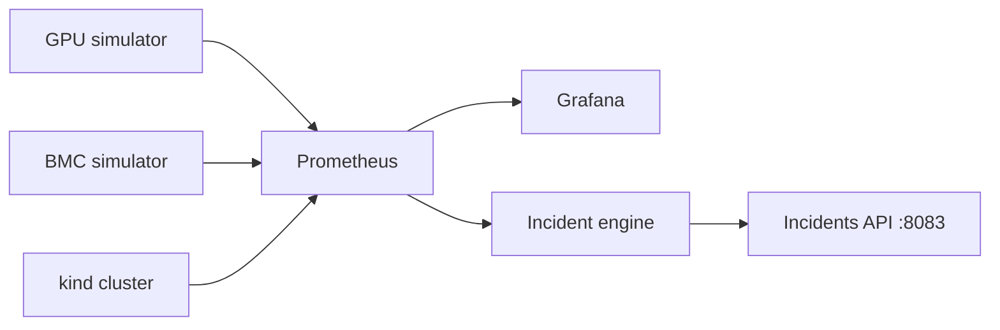
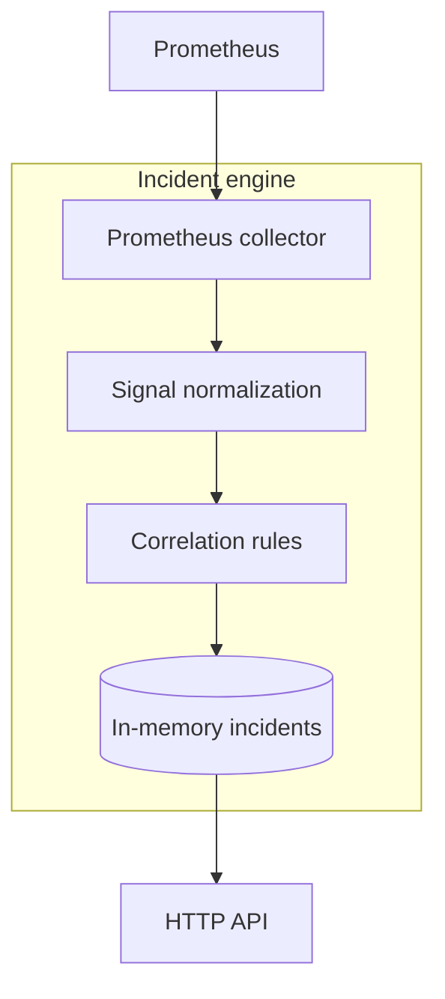
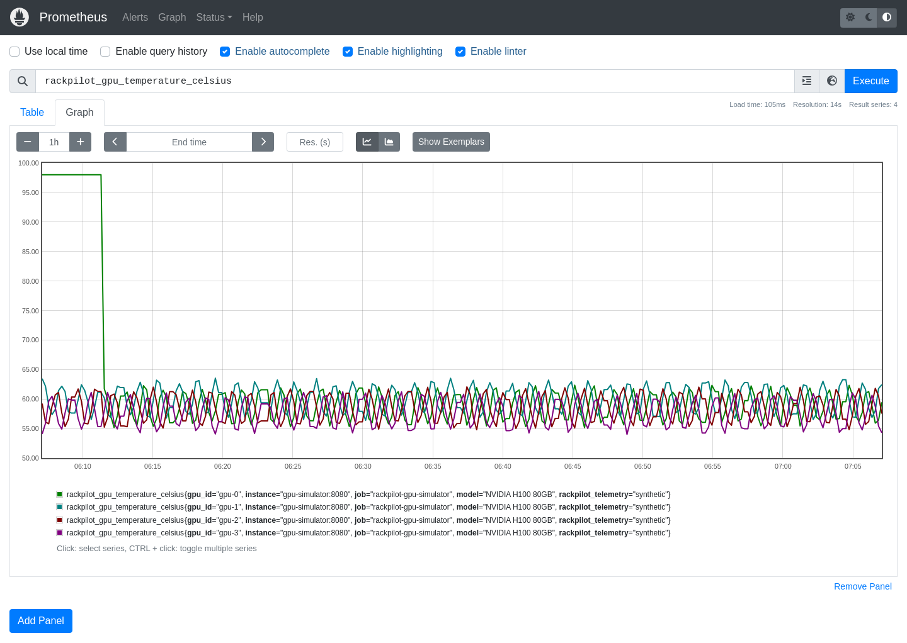

# RackPilot AI

**Synthetic data-center observability lab** — GPU and BMC simulators, Prometheus, Grafana, optional **kind** Kubernetes, and a deterministic **incident correlation engine**.

> All GPU/BMC telemetry and most Redfish responses in default modes are **synthetic**. They do not represent physical hardware.

## Table of contents

- [Purpose](#purpose)
- [Features](#features)
- [Architecture](#architecture)
- [Technology stack](#technology-stack)
- [Repository layout](#repository-layout)
- [Prerequisites](#prerequisites)
- [Quick start (Docker Compose)](#quick-start-docker-compose)
- [Kubernetes (kind)](#kubernetes-kind)
- [Simulators](#simulators)
- [Monitoring](#monitoring)
- [Incident correlation](#incident-correlation)
- [API reference](#api-reference)
- [Configuration](#configuration)
- [Troubleshooting](#troubleshooting)
- [Testing](#testing)
- [Security](#security)
- [Roadmap](#roadmap)
- [Contributing](#contributing)
- [License](#license)

## Purpose

RackPilot AI explores how to **correlate** infrastructure signals (compute, hardware management, Kubernetes) using open observability tools. It is a **development and learning** codebase — not a product deployment claim.

## Features

| Area | Status |
|------|--------|
| Synthetic GPU telemetry simulator | Implemented |
| Synthetic BMC / Redfish simulator | Implemented |
| DMTF Redfish static fixture mode | Implemented |
| Docker Compose observability stack | Implemented |
| kind Kubernetes lab + Prometheus scrape | Implemented |
| Deterministic incident correlation engine | Implemented |
| LLM investigation / auto-remediation | Planned |

## Architecture





See also [docs/incident-correlation.md](docs/incident-correlation.md) and [docs/prometheus-kubernetes.md](docs/prometheus-kubernetes.md).

## Technology stack

- **Go 1.23** — simulators and incident engine  
- **Docker Compose** — local stack (`rackpilot` project)  
- **Prometheus / Grafana** — metrics and dashboards  
- **kind** — optional Kubernetes lab  
- **PromQL** — unified query language for correlation input  

## Repository layout

```
cmd/                    # gpu-simulator, bmc-simulator, incident-engine
simulator/gpu/          # GPU domain, engine, metrics, HTTP API
simulator/bmc/          # BMC/Redfish, fixtures, metrics
incident/               # correlation engine (ingest, rules, store, API)
deployments/docker/     # Compose stack
deployments/kubernetes/ # kind config, workloads, scrape RBAC
monitoring/             # Prometheus + Grafana provisioning
testdata/redfish/dmtf/  # DMTF fixture subset (BSD 3-Clause)
docs/                   # deep-dive guides and images/
```

## Prerequisites

- Linux or macOS with **Docker**  
- **Go 1.23+** for local builds  
- ~4 GiB RAM for Compose + kind control plane  
- Optional: **kind**, **kubectl** for Kubernetes milestone  

## Quick start (Docker Compose)

```bash
git clone https://github.com/anil-debug/rackpilot-ai.git
cd rackpilot-ai
cp deployments/docker/.env.example deployments/docker/.env
# Edit .env if needed — never commit secrets.

docker compose -p rackpilot -f deployments/docker/docker-compose.yml up -d --build
```

Health checks:

```bash
curl -s http://127.0.0.1:8080/health | jq .
curl -s http://127.0.0.1:8082/health | jq .
curl -s http://127.0.0.1:9090/-/healthy
curl -s http://127.0.0.1:3000/api/health | jq .
curl -s http://127.0.0.1:8083/api/v1/health | jq .
```

| Service | URL |
|---------|-----|
| Grafana | http://127.0.0.1:3000 |
| Prometheus | http://127.0.0.1:9090 |
| GPU API | http://127.0.0.1:8080 |
| BMC / Redfish | http://127.0.0.1:8082 |
| Incidents API | http://127.0.0.1:8083 |

**Stop RackPilot only** (does not remove SSD bind mounts):

```bash
docker compose -p rackpilot -f deployments/docker/docker-compose.yml stop
```

Avoid `docker compose down -v` if you rely on `/mnt/ssd/rackpilot-data` persistence (see [docs/observability-docker.md](docs/observability-docker.md)).

## Kubernetes (kind)

Optional lab cluster — details in [deployments/kubernetes/README.md](deployments/kubernetes/README.md).

```bash
export KUBECONFIG=/mnt/ssd/rackpilot-kind/kubeconfig   # or your chosen path
./deployments/kubernetes/kind/create-cluster.sh
./deployments/kubernetes/kind/apply-workloads.sh
./deployments/kubernetes/monitoring/sync-prometheus-k8s-creds.sh
curl -X POST http://127.0.0.1:9090/-/reload
```

API remains on **127.0.0.1** only (e.g. port **16443** in the default kind config).

## Simulators

### GPU

Docs: [docs/gpu-simulator.md](docs/gpu-simulator.md)

```bash
curl -s http://127.0.0.1:8080/api/v1/gpus | jq .
curl -X POST http://127.0.0.1:8080/api/v1/scenarios/overheating \
  -H 'Content-Type: application/json' -d '{"gpu_ids":["gpu-0"]}'
```

### BMC / Redfish

Docs: [docs/bmc-simulator.md](docs/bmc-simulator.md)

```bash
curl -s http://127.0.0.1:8082/redfish/v1/ | jq .
curl -X POST http://127.0.0.1:8082/api/v1/scenarios/fan-failure \
  -H 'Content-Type: application/json' -d '{"component_id":"fan-0"}'
curl -X POST http://127.0.0.1:8082/api/v1/scenarios/reset
```

**Static DMTF fixtures:** `RACKPILOT_BMC_MODE=static` — [docs/redfish-fixtures.md](docs/redfish-fixtures.md)

## Monitoring

### Prometheus targets


### Example queries

| Domain | Screenshot |
|--------|------------|
| GPU |  |
| BMC |  |
| Kubernetes |  |
| Incidents |  |

### Grafana

Dashboards provision automatically under folder **RackPilot**. Capture PNGs for your environment using [docs/images/CAPTURE.md](docs/images/CAPTURE.md) (manual Grafana login required in many setups).

## Incident correlation

Deterministic rules over Prometheus metrics — [docs/incident-correlation.md](docs/incident-correlation.md).

Trigger a lab incident:

```bash
curl -X POST http://127.0.0.1:8082/api/v1/scenarios/fan-failure \
  -H 'Content-Type: application/json' -d '{"component_id":"fan-0"}'
# wait ~1–2 scrape intervals
curl -s http://127.0.0.1:8083/api/v1/incidents/active | jq .
curl -X POST http://127.0.0.1:8082/api/v1/scenarios/reset
```

## API reference

| Endpoint | Description |
|----------|-------------|
| `GET /api/v1/health` | Engine health |
| `GET /api/v1/incidents` | Paginated list (`?offset=&limit=`) |
| `GET /api/v1/incidents/active` | Open/updated incidents |
| `GET /api/v1/incidents/{id}` | Single incident |
| `GET /api/v1/metrics` | Prometheus exposition |

## Configuration

| Variable | Service | Meaning |
|----------|---------|---------|
| `RACKPILOT_PUBLISH_HOST` | Compose | Bind address for published ports (default `127.0.0.1`) |
| `RACKPILOT_BMC_MODE` | BMC | `dynamic` or `static` |
| `RACKPILOT_PROMETHEUS_URL` | Incident engine | Prometheus base URL |
| `RACKPILOT_INCIDENT_LISTEN` | Incident engine | Listen address (default `:8083`) |
| `RACKPILOT_INCIDENT_POLL_MS` | Incident engine | Poll interval |

See `deployments/docker/.env.example`.

## Troubleshooting

| Issue | Action |
|-------|--------|
| No Kubernetes metrics | Run `sync-prometheus-k8s-creds.sh`, reload Prometheus, confirm `kind` network attached |
| No incidents | Confirm Prometheus targets UP; trigger BMC/GPU scenario; check `rackpilot_correlation_errors_total` |
| kind API unreachable | Use dedicated `KUBECONFIG`; API on loopback only |

## Testing

```bash
gofmt -w $(find . -path ./.git -prune -o -name '*.go' -print)
go vet ./...
go build ./...
go test ./...
go test -race ./...
```

## Security

- Default Grafana credentials are **development only** — change before exposure.  
- Do not commit `.env`, kubeconfig tokens, or `/mnt/ssd/.../prometheus/k8s/token`.  
- Incident engine uses a **dedicated** Kubernetes scrape ServiceAccount, not an admin kubeconfig.  
- Publish services on `127.0.0.1` unless you explicitly widen `RACKPILOT_PUBLISH_HOST`.

## Roadmap

- Redfish EventLog ingestion into the signal model  
- Persistent incident store  
- Policy-gated remediation (no LLM required for basic playbooks)  
- Optional LLM-assisted investigation (future milestone)  

## Contributing

Use conventional commits; open focused PRs. See existing package layout under `simulator/` and `incident/`.

## License

Apache License 2.0 — see [LICENSE](LICENSE) (project). DMTF fixtures under `testdata/redfish/dmtf/` are BSD 3-Clause — see `LICENSE.BSD` and `NOTICE.md`.