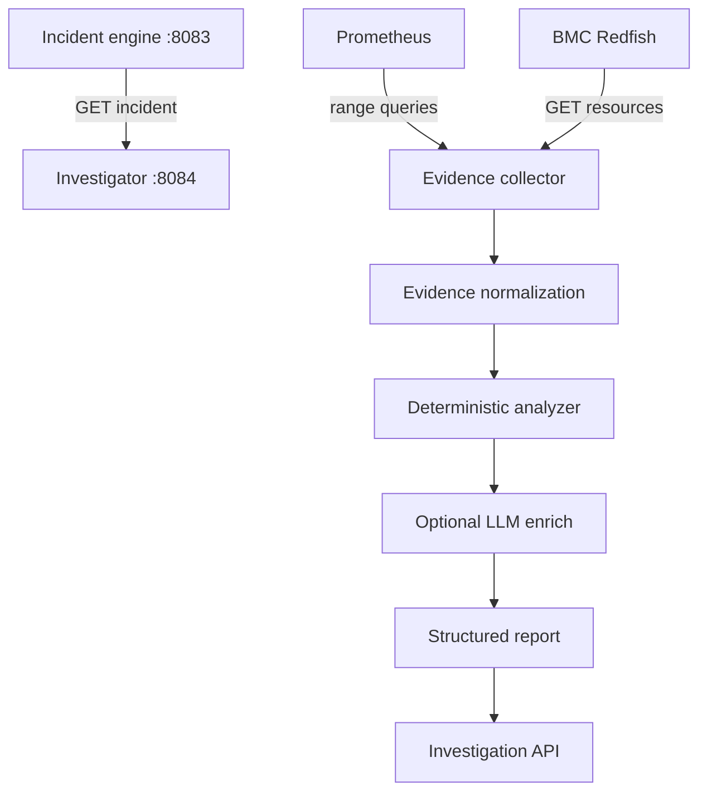

# AI-assisted root-cause investigation (Milestone 6)

The **investigator** service is a **read-only** companion to the incident correlation engine. It does not execute BMC commands, change firmware, restart pods, or run shell on infrastructure.

## Flow



## Evidence model

Each `EvidenceItem` includes: `evidence_id`, `source`, `timestamp`, `resource`, metric/event name, value, `provenance` (`synthetic_live`, `kubernetes_metrics`, `redfish_synthetic`, `redfish_dmtf_fixture`), and `source_reference`.

Prometheus history uses a configurable window around `first_seen` / `last_seen` (default **10m before**, **5m after** via `RACKPILOT_EVIDENCE_BEFORE` / `RACKPILOT_EVIDENCE_AFTER`).

Contributor signals from the incident are copied into the timeline with original timestamps.

## Investigation modes

| Mode | Env | Behavior |
|------|-----|----------|
| **deterministic** (default) | `RACKPILOT_INVESTIGATOR_MODE=deterministic` | Rule-aware hypotheses and evidence ID references; no external API |
| **llm** | `RACKPILOT_INVESTIGATOR_MODE=llm` + `RACKPILOT_LLM_API_KEY` | OpenAI-compatible chat completion; malformed output or unknown evidence IDs → fallback to deterministic fields |

LLM output cannot mark root causes as **confirmed**; the API always leaves `confirmed_root_causes` empty unless future milestones add validation gates.

## API

Base URL (Compose): `http://127.0.0.1:8084`

```bash
# Health
curl -s http://127.0.0.1:8084/api/v1/health | jq .

# Start investigation for an existing incident
curl -s -X POST http://127.0.0.1:8084/api/v1/investigations \
  -H 'Content-Type: application/json' \
  -d '{"incident_id":"<id-from-incident-engine>"}' | jq .

# List / get
curl -s 'http://127.0.0.1:8084/api/v1/investigations?limit=20' | jq .
curl -s http://127.0.0.1:8084/api/v1/investigations/<investigation_id> | jq .
curl -s http://127.0.0.1:8084/api/v1/investigations/<investigation_id>/evidence | jq .

# Prometheus metrics
curl -s http://127.0.0.1:8084/metrics | grep rackpilot_investigation
```

HTTP status:

- **201** — completed investigation with evidence  
- **206** — partial (some providers failed)  
- **422** — failed collection (no usable evidence)  
- **404** — unknown incident  

## Storage

Investigations are stored **in memory** in the investigator process. Reports are lost on container restart.

## Example workflow (fan failure)

```bash
# 1) Trigger BMC fan failure scenario (dynamic mode)
curl -s -X POST http://127.0.0.1:8082/api/v1/scenarios/fan-failure \
  -H 'Content-Type: application/json' \
  -d '{"component_id":"fan-0"}' | jq .

# 2) Wait for Prometheus scrape + incident poll (~45–60s)
curl -s http://127.0.0.1:8083/api/v1/incidents/active | jq .

# 3) Investigate
INCIDENT_ID=$(curl -s http://127.0.0.1:8083/api/v1/incidents/active | jq -r '.data[0].incident_id')
curl -s -X POST http://127.0.0.1:8084/api/v1/investigations \
  -H 'Content-Type: application/json' \
  -d "{\"incident_id\":\"$INCIDENT_ID\"}" | jq .
```

## Security boundaries

- No cluster-admin kubeconfig in the investigator  
- Kubernetes evidence comes from **Prometheus** (`kube_*` series), not direct API mutation  
- Redfish access is HTTP GET to the BMC simulator only  
- Credentials for LLM are environment variables only; never logged  

## Limitations

- Causation is hypothesis-level; see `causation_disclaimer` in reports  
- Static DMTF fixture mode does not provide live fan/PSU dynamics — provenance is labeled  
- Long Prometheus ranges may be empty for brief incidents  
- Approval-based remediation is **not** implemented (future milestone)  