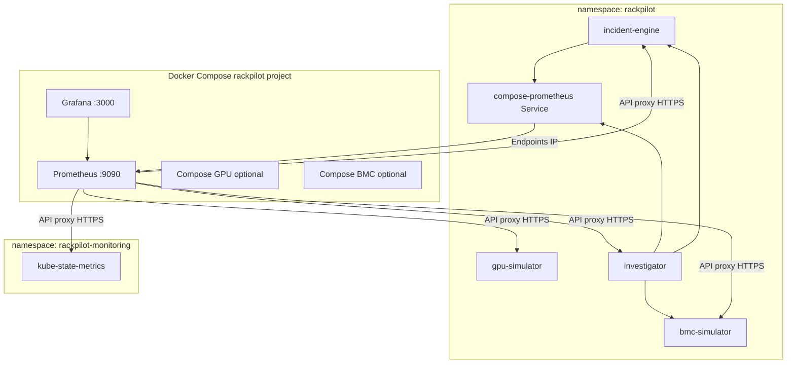

# Kubernetes deployment (Milestone 7)

RackPilot supports **two** deployment models:

| Method | Use case |
|--------|----------|
| [Docker Compose](../deployments/docker/docker-compose.yml) | Local dev, single-host, published ports on `127.0.0.1` |
| **Kubernetes (kind)** | Kubernetes-native orchestration of the four application services |

**Milestone 7.1:** Prometheus and Grafana run in `rackpilot-monitoring`. See [kubernetes-monitoring-migration.md](kubernetes-monitoring-migration.md). Compose monitoring can remain as a fallback until you stop it manually.

## Architecture



**Limitations (single-node kind):**

- No HA; one replica per service  
- Incident/investigator state is **in-memory**  
- Compose and Kubernetes simulators may both be scraped — use `rackpilot_deployment=kubernetes` or `instance` labels to filter  
- `compose-prometheus` Endpoints IP can change if the Prometheus container is recreated — re-run `deploy.sh`  
- Not production-grade; lab and portfolio use only  

## Prerequisites

- Existing cluster: `rackpilot-kind` (`KUBECONFIG=/mnt/ssd/rackpilot-kind/kubeconfig`)  
- Running Compose stack with Prometheus on Docker network `kind`  
- `kubectl`, `kind`, `docker`  

## Build and load images

```bash
./deployments/kubernetes/build-and-load-images.sh
```

Rebuild after Go changes, then redeploy.

## Deploy

```bash
./deployments/kubernetes/deploy.sh
```

This applies manifests, patches Prometheus Endpoints, syncs scrape credentials, and reloads Prometheus.

## Access (port-forward)

BMC host port in Compose is **8082** → container **8081**. In Kubernetes the Service port is **8081**.

```bash
kubectl port-forward -n rackpilot svc/gpu-simulator 8080:8080
kubectl port-forward -n rackpilot svc/bmc-simulator 8082:8081
kubectl port-forward -n rackpilot svc/incident-engine 8083:8083
kubectl port-forward -n rackpilot svc/investigator 8084:8084
```

## LLM mode (optional)

```bash
kubectl create secret generic rackpilot-llm -n rackpilot \
  --from-literal=RACKPILOT_LLM_API_KEY='your-key'
kubectl set env deployment/investigator -n rackpilot RACKPILOT_INVESTIGATOR_MODE=llm
```

See [secrets/rackpilot-llm-secret.yaml.example](../deployments/kubernetes/secrets/rackpilot-llm-secret.yaml.example).

## Status and cleanup

```bash
./deployments/kubernetes/status.sh
./deployments/kubernetes/delete.sh   # interactive confirmation
```

## E2E (Kubernetes path)

Use port-forward to the **Kubernetes** BMC service, not Compose:

```bash
kubectl port-forward -n rackpilot svc/bmc-simulator 18082:8081 &
curl -s -X POST http://127.0.0.1:18082/api/v1/scenarios/fan-failure \
  -H 'Content-Type: application/json' -d '{"component_id":"fan-0"}'
# wait ~60s for k8s BMC scrape + K8s incident-engine poll
kubectl port-forward -n rackpilot svc/incident-engine 18083:8083 &
curl -s http://127.0.0.1:18083/api/v1/incidents/active | jq .
kubectl port-forward -n rackpilot svc/investigator 18084:8084 &
curl -s -X POST http://127.0.0.1:18084/api/v1/investigations \
  -H 'Content-Type: application/json' \
  -d '{"incident_id":"<id>"}' | jq .
curl -s -X POST http://127.0.0.1:18082/api/v1/scenarios/reset
```